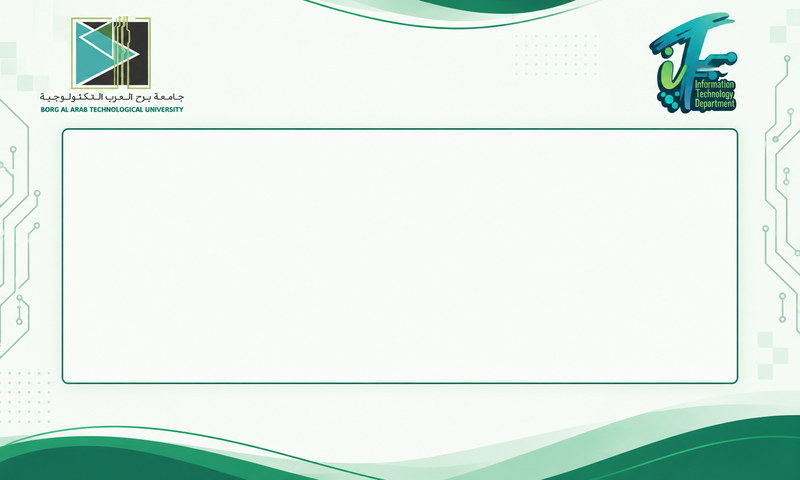

# NeuralNexus Screen — شاشة رسائل DWIN + ESP32 + موبايل

<p align="center"></p>

مشروع لعرض رسائل **عربي وإنجليزي** على شاشة **DWIN DGUS II مقاس 7 بوصة** في **قسم تكنولوجيا المعلومات – جامعة برج العرب التكنولوجية**. الرسالة بتتبعت من **أبلكيشن موبايل** أو **صفحة ويب**، بتعدّي على **ESP32** عامل شبكة واي فاي خاصة بيه، والـ ESP32 بيكتبها على الشاشة.

```
 موبايل / لابتوب  ──Wi-Fi──>  ESP32 (192.168.4.1)  ──UART 115200──>  MAX3232  ──RS232──>  شاشة DWIN (R2/T2)
 (أبلكيشن أو ويب)              شبكة: NeuralNexus-Screen                                      DMG80480T070_15WTR
```

## ابدأ من هنا

| الخطوة | الدليل |
|---|---|
| 1. تجهيز كارت الـ SD (الفورمات الصح) | [docs/01_SD_CARD.md](docs/01_SD_CARD.md) |
| 2. الشاشة ونسختها وحرق الملفات عليها | [docs/02_SCREEN_DWIN.md](docs/02_SCREEN_DWIN.md) |
| 3. الخطوط العربي والإنجليزي (حل الحروف الملخبطة) | [docs/03_FONTS_ARABIC_ENGLISH.md](docs/03_FONTS_ARABIC_ENGLISH.md) |
| 4. توصيل الهاردوير (ESP32 – MAX3232 – الشاشة) | [docs/04_HARDWARE_WIRING.md](docs/04_HARDWARE_WIRING.md) |
| 5. كود الـ ESP32 وحرقه | [docs/05_ESP32_FIRMWARE.md](docs/05_ESP32_FIRMWARE.md) |
| 6. أبلكيشن الموبايل وصفحة الويب | [docs/06_MOBILE_APP_AND_WEB.md](docs/06_MOBILE_APP_AND_WEB.md) |
| 7. كل المشاكل اللي قابلناها وحلها | [docs/07_PROBLEMS_AND_SOLUTIONS.md](docs/07_PROBLEMS_AND_SOLUTIONS.md) |
| 8. بروتوكول الشاشة (للمطورين) | [docs/08_DWIN_PROTOCOL.md](docs/08_DWIN_PROTOCOL.md) |

## محتوى الريبو

```
screen/
  SD_CARD/DWIN_SET/        ← الملفات اللي بتتحط على الكارت وتتحرق على الشاشة (جاهزة)
  dgus_project/            ← مشروع برنامج DGUS (الخلفية 800x480)
  sd_tools/                ← سكريبتات فورمات الكارت ونسخ الملفات والتأكد منها
  font_tools/              ← سكريبتات توليد الخط الإنجليزي والعربي (Python)
firmware/NeuralNexusScreen/ ← كود الـ ESP32 (Arduino) + صفحة الويب + صفحة الفحص
mobile-app/                ← أبلكيشن أندرويد (WebView + اتصال native بالـ ESP32)
docs/                      ← الشرح خطوة بخطوة
images/                    ← صور
```

## المواصفات المختصرة

- **الشاشة:** DWIN `DMG80480T070_15WTR`، مقاس 800×480، نسخة الكيرنل `T5L1 DGUS2 V6.5 2024.05.15`، منفذ UART2 (R2/T2) على RS232.
- **الكارت:** FAT32، الـ Allocation unit = **4096 بايت**، بارتيشن **8GB أو أقل**، وفولدر `DWIN_SET` على الروت.
- **الخانة:** VP `0x2000`، طولها 160 بايت (32 حرف × 5 سطور)، ترميز **GB2312**، والخط الإنجليزي `24_ASC.HZK` (20×40) والعربي `28_AR.HZK` (40×40)، ولون الكلام أسود.
- **الـ ESP32:** ESP32-DevKit V1، الشاشة على **RX0/TX0** (GPIO3/1) عن طريق MAX3232، سرعة 115200، والواي فاي `NeuralNexus-Screen` بالباسورد `12345678`.
- **الويب:** `http://192.168.4.1` للصفحة الأساسية، و`http://192.168.4.1/diag` لصفحة الفحص والتقرير.

---

### English summary

Arabic + English message board on a **DWIN DMG80480T070_15WTR (T5L, DGUS II V6.5)** driven by an **ESP32** SoftAP web server; messages come from an Android app or the built-in web page.

**Key findings:**
- On this kernel, **8-bit text with the multi-size 0# ASCII font renders garbage**. What works is **GB2312 encoding** with an ASCII font (ID 24) plus a custom Arabic glyph font (ID 28) in GB2312 layout. The ESP32 does the Arabic shaping and right-to-left ordering.
- SD card: FAT32 with 4 KB clusters, ≤ 8 GB partition.
- A solder bridge between RX0 and TX0 on the carrier board killed UART in both directions.

See `docs/` for everything.
