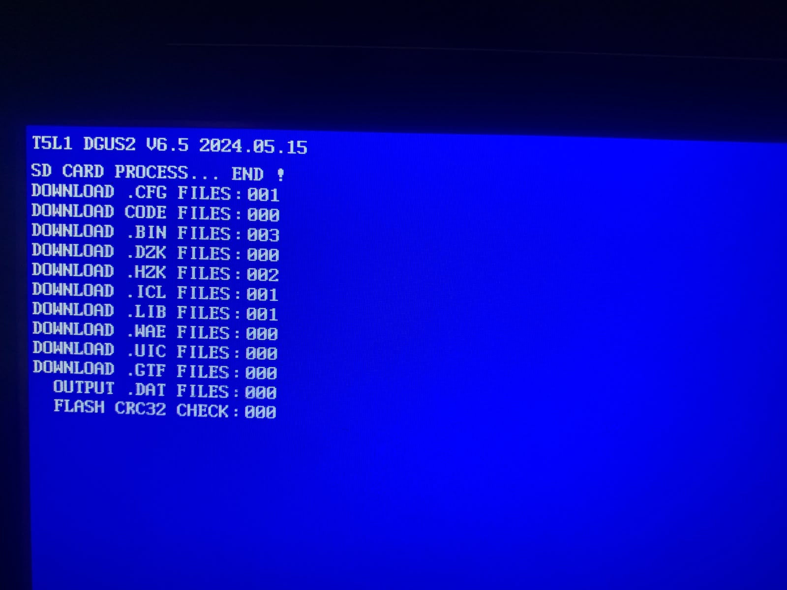

# 1) تجهيز كارت الـ SD

الشاشة (T5L) **حساسة جدًا لفورمات الكارت**. لو الفورمات غلط، شاشة الحرق الزرقا بتطلع كل الأرقام `000` ومش بتحمّل أي ملف.

## الشروط

| البند | لازم يكون |
|---|---|
| نظام الملفات | **FAT32** |
| Allocation unit (cluster) | **4096 bytes** (يعني 4 KB). مش 32 KB ولا Default |
| حجم البارتيشن | **8 GB أو أقل** (ينفع لحد 16 GB، بس 8 هو اللي اتجرب) |
| الفولدر | `DWIN_SET` على **الروت** مباشرة (`F:\DWIN_SET`) |
| الملفات جوه | الملفات المطلوبة **بس**، من غير أي ملفات قديمة أو نسخ |

> **مشكلة قابلناها:** برنامج Rufus عمل الكارت 128GB بـ cluster مقاسه **32 KB**، فالشاشة ماقريتش حاجة. وويندوز مابيرضاش يعمل FAT32 لبارتيشن أكبر من 32GB. الحل إننا عملنا **بارتيشن 8GB** بس على الكارت، بـ cluster مقاسه 4096.

## أي كارت ينفع؟

- **أي كارت microSD أو SD عادي (SDHC)**، حتى لو كبير زي 64 أو 128GB. السكريبت بيعمل عليه بارتيشن 8GB بس، والباقي بيتساب فاضي.
- كروت SDXC الكبيرة جاية فورمات exFAT من المصنع، والشاشة **مابتقراش exFAT**، فلازم تتعمل فورمات.
- لو الكارت بيتقري عن طريق قارئ كروت جوه اللابتوب (Realtek مثلًا)، ويندوز ساعات بيعرّفه على إنه `SCSI` مش `USB`. السكريبت بيتعامل مع ده.

## الطريقة الأوتوماتيك (ويندوز)

1. حط الكارت في الكمبيوتر، واعرف حرفه (مثلًا `F:`).
2. شغّل `screen/sd_tools/PREPARE_SD_CARD.bat` **كـ Administrator**.
   - السكريبت بيمسح الكارت، ويعمل بارتيشن 8GB بـ FAT32 وcluster مقاسه 4096، ويسميه `SD`، وبعدين ينسخ الملفات ويتأكد منها. السكريبت ده مكتوب على حرف `F:`.
   - **بيمسح كل اللي على الكارت.** اتأكد إن الحرف هو حرف الكارت، والسكريبت هيطلب منك تكتب YES.
3. بعد كده، لو حبيت تحدّث الملفات بس من غير فورمات، شغّل `screen/sd_tools/COPY_FILES_TO_SD.bat`:
   - بيمسح أي حاجة قديمة جوه `F:\DWIN_SET`.
   - بينسخ الملفات من `screen/SD_CARD/DWIN_SET`.
   - **بيتأكد من كل ملف بالـ MD5**، ويكتب `ALL GOOD`، ويحفظ تقرير اسمه `SD_CHECK_v1.txt` على الكارت.

## الطريقة اليدوية

افتح **cmd كـ Administrator** واكتب:

```bat
diskpart
list disk
select disk N          ← رقم الكارت (اتأكد كويس!)
clean
create partition primary size=8192
format fs=fat32 unit=4096 label=SD quick
assign letter=F
exit
```

للتأكد إن الفورمات صح:

```bat
chkdsk F:
```

لازم تلاقي في الناتج: `4,096 bytes in each allocation unit`.

بعد كده انسخ فولدر `screen/SD_CARD/DWIN_SET` كله على `F:\`.

## الملفات اللي على الكارت

| الملف | وظيفته |
|---|---|
| `T5LCFG.CFG` | إعدادات الشاشة: سرعة 115200، من غير CRC، تحميل ملف 22، الإضاءة 100% |
| `13TouchFile.bin` | إعدادات اللمس (فاضي) |
| `14ShowFile.bin` | تعريف خانة الرسالة: المكان والخط والترميز واللون |
| `22_Config.bin` | القيم اللي الشاشة بتبدأ بيها (الكلام الافتراضي "BORG EL ARAB TECHNOLOGICAL UNIVERSITY" + إعدادات الخانة) |
| `24_ASC.HZK` | الخط الإنجليزي والأرقام |
| `28_AR.HZK` | الخط العربي (أشكال الحروف المتصلة) |
| `32.icl` | صورة الخلفية 800×480 (معمولة بأداة ICLGenerator الرسمية) |
| `120.lib` | ملف مكتبة من مشروع DGUS |

النتيجة المتوقعة على شاشة الحرق الزرقا:



```
DOWNLOAD .CFG FILES : 001
DOWNLOAD .BIN FILES : 003
DOWNLOAD .HZK FILES : 002
DOWNLOAD .ICL FILES : 001
DOWNLOAD .LIB FILES : 001
```
