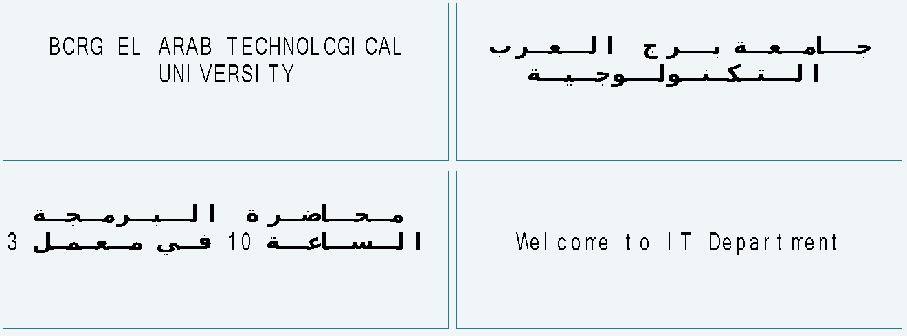

# 3) الخطوط: إزاي حلّينا الحروف الملخبطة وخلّينا العربي يظهر

## المشكلة

الكلام كان بيظهر على الشاشة **حروف حمرا ملخبطة**، بس في مكانه الصح وبعدد الكلمات الصح. يعني الشاشة كانت بتستقبل الكلام، والمشكلة في **الخط** بس.

## اللي اكتشفناه بالاختبار على الشاشة نفسها

عملنا كارت اختبار بيعرض 6 سطور، كل سطر بإعداد مختلف، وصوّرنا الشاشة:

### الإنجليزي

| # | الترميز | الخط | الحجم | النتيجة |
|---|---|---|---|---|
| 1 | 8-bit (0x00) | خط بكل الأحجام في ملف واحد (زي `0_DWIN_ASC.HZK`) | 20×40 | ❌ ملخبط |
| 2 | 8-bit | **خط بحجم واحد** 20×40 (256 حرف) | 20×40 | ✅ واضح وكبير |
| 3 | 8-bit | خط بحجم واحد 16×32 | 16×32 | ✅ واضح |
| 4 | 8-bit | خط بكل الأحجام | 16×32 | ❌ |
| 5 | **GBK** (0x02) | خط بكل الأحجام كـ Font0 | 32×32 | ✅ واضح |
| 6 | 8-bit | خط المصنع (المكان 0) | 16×32 | ❌ |

### العربي

| # | الترميز | الخط العربي | الحجم | النتيجة |
|---|---|---|---|---|
| 1 | **GB2312** (0x01) | ترتيب GB2312 (من A1A1) | 40×40 | ✅ **الأحسن، وده اللي اخترناه** |
| 2 | GBK | ترتيب GBK بـ 192 في الصف | 40×40 | ❌ |
| 3 | GBK | ترتيب GBK بـ 190 في الصف | 40×40 | ✅ |
| 4 | GB2312 | ترتيب GB2312 | 32×32 | ✅ أصغر |

### الخلاصة

- **نسخة الشاشة دي (V6.5) مابتقراش الخط اللي فيه كل الأحجام لما تكون على ترميز 8-bit.** ده كان سبب الكلام الملخبط من الأول، حتى مع خط المصنع.
- **الحل النهائي:** ترميز **GB2312** للكلام كله:
  - الحروف الإنجليزي والأرقام (بايت أقل من 0x80) بتتقري من **Font0 = 24** (`24_ASC.HZK`، فيه كل الأحجام من 4 لـ 32) بحجم 20×40.
  - الحروف العربي (بايتين من A1A1 وطالع) بتتقري من **Font1 = 28** (`28_AR.HZK`) بحجم 40×40.
  - إعداد واحد بيعرض الإنجليزي والعربي والمخلوط، من غير ما نبدّل بين أوضاع.

## الخط العربي `28_AR.HZK`

- معمول بسكريبت `screen/font_tools/genar2.py` من خط **DejaVu Sans Bold**.
- فيه **أشكال الحروف المتصلة** (Unicode Presentation Forms-B من `U+FE70` لـ `U+FEFC`): لوحده، وأول الكلمة، ووسطها، وآخرها، ولام ألف. وفيه كمان الأرقام العربي (٠–٩) و`، ؛ ؟ ـ`.
- كل حرف في خانة 40×40. ولما الحرف بيتشبك، بنمد خط الوصل لحد طرف الخانة علشان الحروف تبان متصلة.
- الحرف رقم `i` محطوط على الكود `(0xA1 + i/94, 0xA1 + i%94)` بترتيب GB2312 القياسي، وحجم كل حرف 200 بايت.

## الخط الإنجليزي `24_ASC.HZK`

- أول جزء من خط DWIN الأصلي `0_DWIN_ASC.HZK`، وفيه الأحجام من 4×8 لحد 32×64.
- الحجم n بيبدأ من `offset = Σ ceil(k/8)·2k·128` لكل k من 4 لحد n−1. وكل حجم فيه 128 حرف.

## مين بيعمل تشبيك العربي؟

**الـ ESP32**، في ملف `firmware/NeuralNexusScreen/screen_text.h`:
1. بيفك ترميز UTF-8 اللي جاي من الموبايل، وبيشيل التشكيل.
2. **بيشبّك الحروف**: بيختار الشكل الصح لكل حرف حسب اللي قبله واللي بعده، وبيعمل لام ألف.
3. بيقسّم الكلام على سطور بالكلمة (32 عمود × 5 سطور). الحرف العربي بياخد عمودين، والإنجليزي عمود واحد.
4. **بيرتّب كل سطر من اليمين للشمال**، والكلام الإنجليزي والأرقام اللي جوه الجملة بيفضلوا في اتجاههم الطبيعي.
5. بيحط كل سطر في النص، وبيحوّل كل حرف عربي لكود GB2312.

السكريبت `screen/font_tools/shape.py` فيه نفس الخطوات بـ Python، وبيرسم صورة توضح شكل الشاشة:



## إعادة توليد الخطوط

```bash
pip install pillow
cd screen/font_tools
# محتاج 0_DWIN_ASC.HZK الأصلي من فولدر برنامج DGUS (عدّل المسار في gen.py)
python gen.py      # يطلع 24_ASC.HZK
python genar2.py   # يطلع 28_AR.HZK (ونسخ تجريبية تانية)
```
